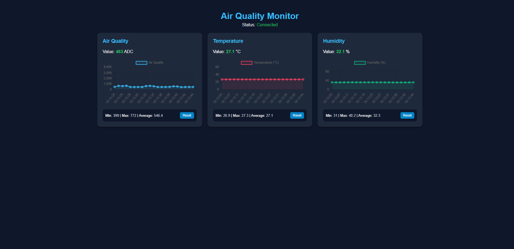

# 🌍 ESP32 Real-Time IoT Air Quality Monitor

A professional full-stack IoT environment monitoring system powered by an **ESP32** microcontroller utilizing **FreeRTOS**, a **Node.js WebSocket backend**, and a modern web dashboard featuring live multi-charts and real-time statistics.

---

## 🚀 Key Features
* **Microcontroller & FreeRTOS Architecture:** Runs multiple concurrent preemptive tasks on the ESP32 (handling sensor readings, display updates, buzzer alarms, and network communication without blocking).
* **Sensors & Peripherals:**
  * **MQ-2 / MQ-135:** Analog gas sensor for air quality and pollution detection.
  * **DHT11:** Precision temperature and humidity sensor.
  * **SSD1306 OLED (0.96"):** SPI-based local display showing live metrics.
  * **Buzzer:** Hardware alert system triggered when air quality exceeds safety thresholds.
* **Communication Protocol:** Real-time bi-directional data transmission using **WebSockets** over Wi-Fi.
* **Backend Server:** **Node.js** server acting as a data bridge between the ESP32 hardware and the browser client.
* **Frontend Dashboard:** Modern, responsive UI built with **HTML5, CSS3, and JavaScript**, featuring live **Chart.js** telemetry, real-time statistics (Min, Max, Average), and a live connection status indicator.

---

## 🛠️ Tech Stack & Architecture
* **Hardware:** ESP32 DevKit V1, MQ-2/MQ-135, DHT11, SSD1306 OLED, Active Buzzer
* **Embedded Software:** Arduino IDE, FreeRTOS, Adafruit GFX/SSD1306, WebSocketsClient
* **Backend:** Node.js, `ws` (WebSocket library)
* **Frontend:** HTML5, CSS3, JavaScript, Chart.js

---

## 📂 Repository Structure
* `firmware/` - Arduino C/C++ source code for the ESP32, including FreeRTOS task definitions and hardware drivers.
* `backend/` - Node.js server script (`server.js`) and dependencies (`package.json`).
* `frontend/` - Web dashboard interface (`index.html`) with embedded Chart.js logic and WebSocket client handling.
* `images/` - Project screenshots and UI previews.

---

## 🖼️ Dashboard Preview

---

## 📹 Video Demonstration

| Operational View | Description | Video Link |
| :--- | :--- | :--- |
| **System Demo** | Live hardware operation, sensor response, OLED display, and web dashboard telemetry | [▶️ Watch Video Demo](https://youtube.com/shorts/WvLMer2l8bI) |

---

## ⚙️ Pinout & Hardware Topology (ESP32 DevKit V1)
* **DHT11 Sensor:** Pin `13`
* **MQ Gas Sensor:** Pin `35` (ADC Analog)
* **Buzzer:** Pin `25`
* **SSD1306 OLED (SPI):** 
  * MOSI: `23`
  * CLK: `18`
  * D/C: `2`
  * CS: `5`
  * RESET: `4`
